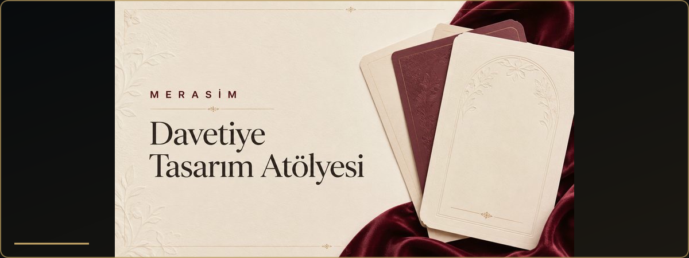
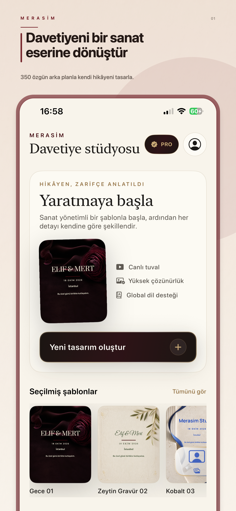
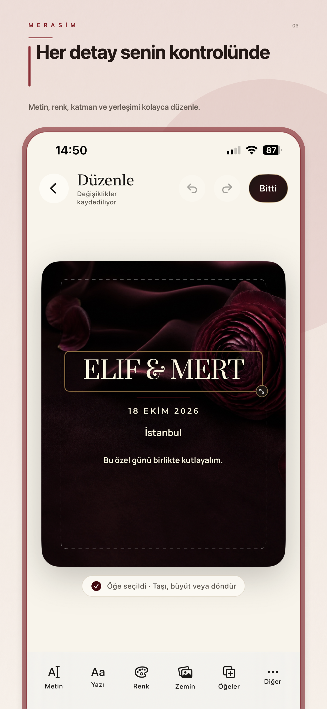
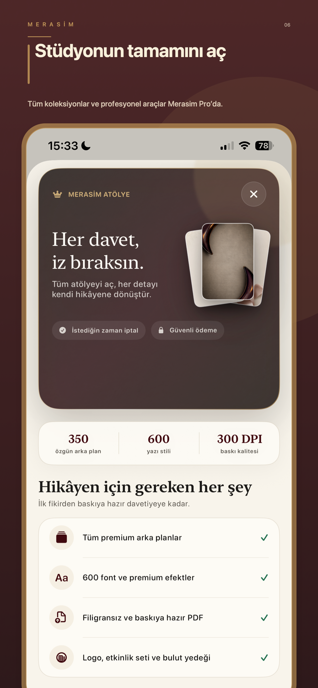
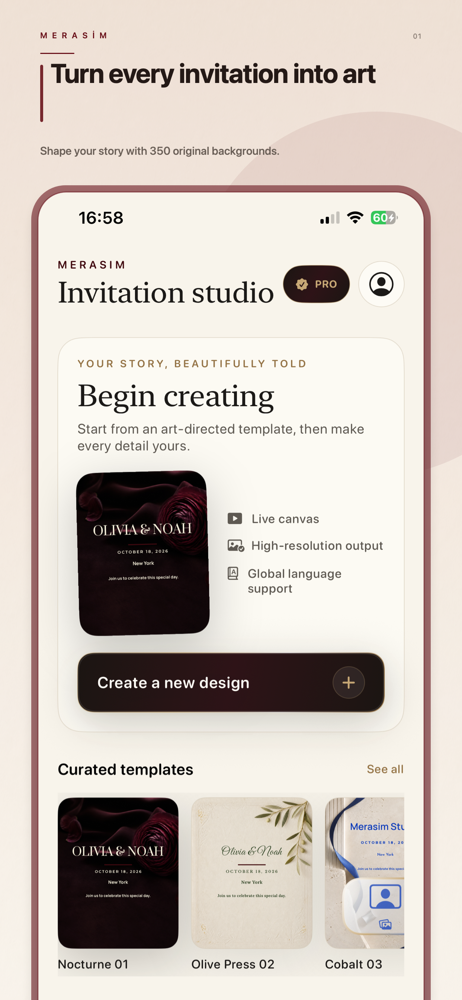
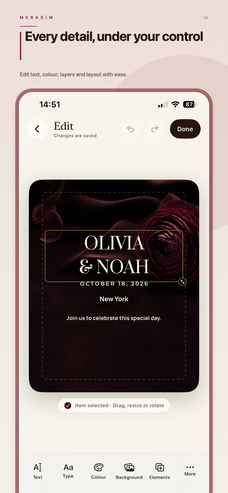
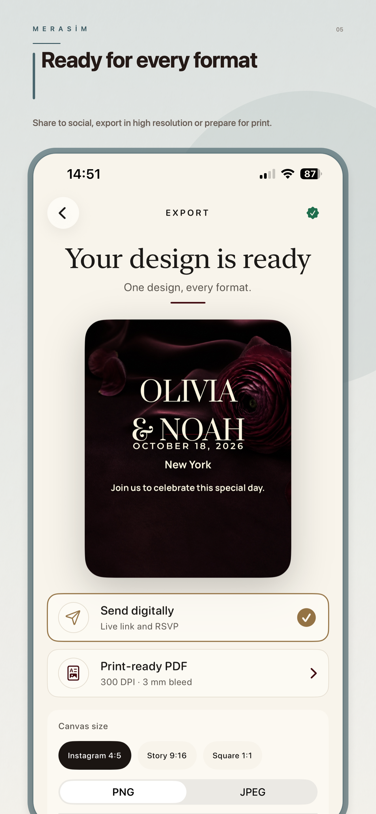

<h1 align="center">Merasim</h1>

  <strong>Özel anları zarif, hareketli ve paylaşılabilir davetiyelere dönüştüren tasarım stüdyosu.</strong>

  
  
  
  
  

  
  
  

## Ürün özeti

| | |
| --- | --- |
| **Amaç** | Davetiye hazırlama sürecini seçimden dışa aktarmaya kadar tek akışta sadeleştirmek. |
| **Kapsam** | Düğün, nişan, doğum günü, bebek kutlaması, mezuniyet ve kurumsal etkinlikler. |
| **Tasarım sistemi** | 350 arka plan, 200 çerçeveli şablon, 600 tipografi stili ve 24 renk paleti. |
| **Çıktılar** | PNG, JPEG, şeffaf PNG ve baskıya hazır PDF. |

## Öne çıkanlar

- Katman, hizalama, tipografi, renk, efekt ve hareket kontrolleri
- 120 hareketli davetiye sahnesi
- Cihaz üzerinde fotoğraf arka planı kaldırma
- Kişisel fotoğraflar için çerçeveli şablonlar
- iPhone ve iPad’e uyarlanmış SwiftUI deneyimi
- 12 dilde yerelleştirilmiş arayüz ve önizleme metinleri
- İsteğe bağlı bulut yedekleme ve satın alma geri yükleme

## Tasarım ilkeleri

- **Sade başlangıç:** Güçlü araçlar, kalabalık görünmeyen bir editör içinde sunulur.
- **Sessiz premium:** Tipografi, boşluk, renk ve hareket içeriğin önüne geçmez.
- **Yerelleştirilmiş deneyim:** Arayüz ve örnek metinler seçilen dile uyarlanır.
- **Cihaz odaklı işleme:** Fotoğraf ayırma işlemi cihaz üzerinde tamamlanır.

## English

Merasim is a native SwiftUI invitation studio for iPhone and iPad. It combines hundreds of backgrounds, framed photo templates, typography styles, colour palettes and animated scenes with on-device subject isolation and print-ready export.

  
  
  

© 2026 Merasim. All rights reserved.
