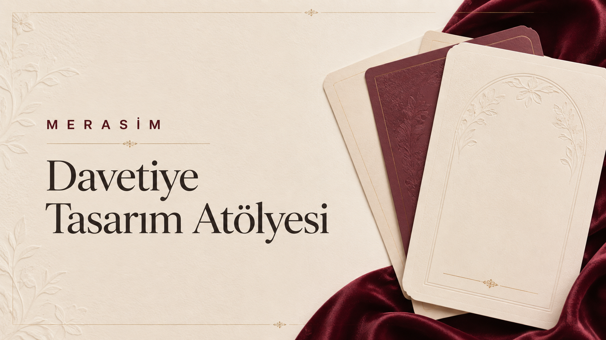
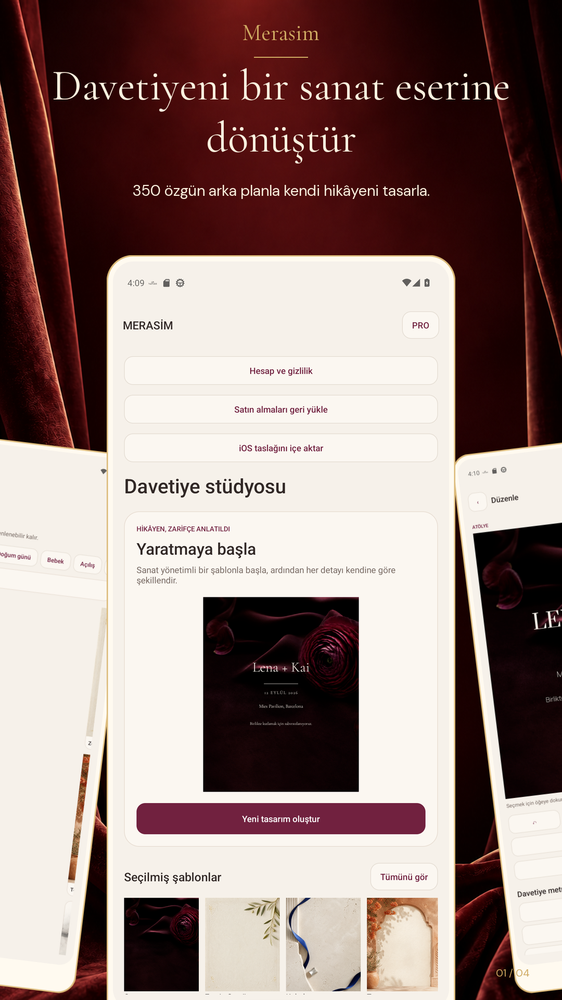
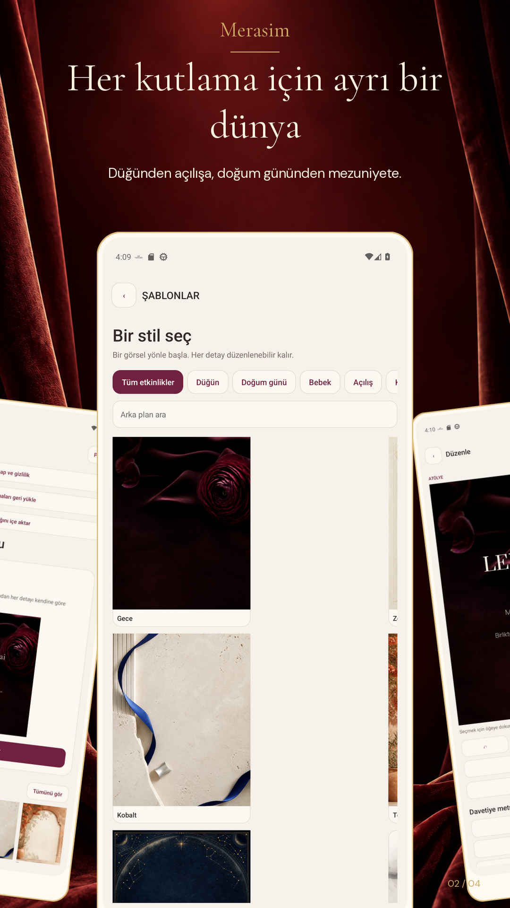
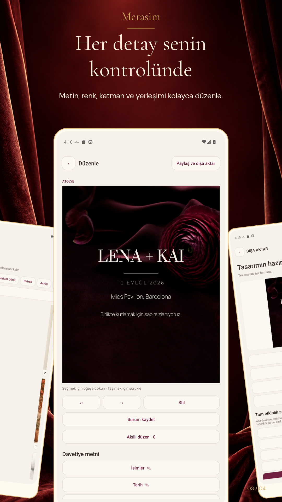
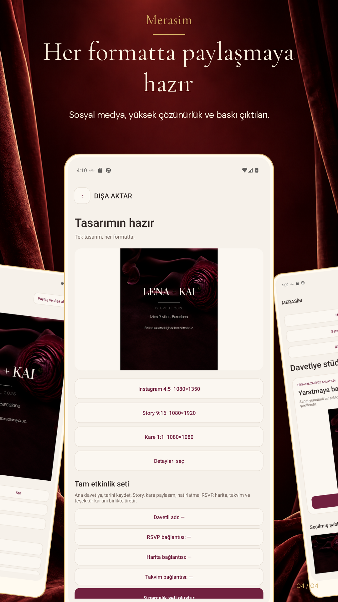
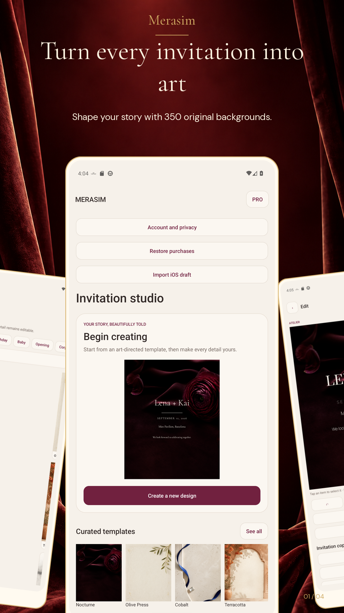
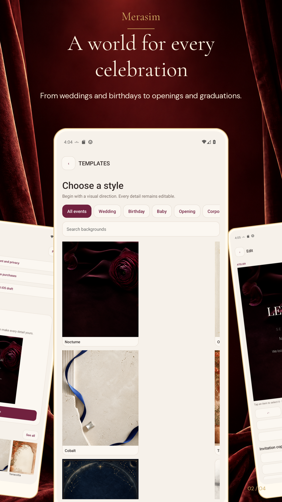
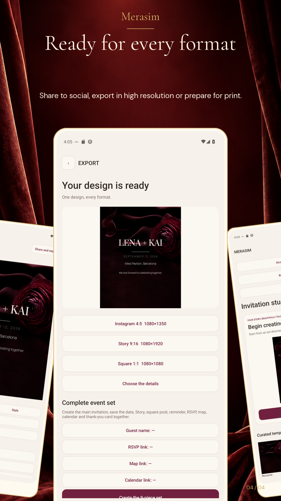

<h1 align="center">Merasim</h1>

  <strong>Özel anları zarif, hareketli ve paylaşılabilir davetiyelere dönüştüren tasarım stüdyosu.</strong> 
  iPhone, iPad ve Android için.

  
  
  
  

## Ürün özeti

| | |
| --- | --- |
| **Amaç** | Davetiye hazırlama sürecini şablon seçiminden dışa aktarmaya kadar tek akışta sadeleştirmek. |
| **Kapsam** | Düğün, nişan, doğum günü, bebek kutlaması, mezuniyet ve kurumsal etkinlikler. |
| **Tasarım sistemi** | 350 arka plan, 200 çerçeveli fotoğraf şablonu, yüzlerce tipografi seçeneği ve 24 renk paleti. |
| **Düzenleme** | Katman, hizalama, metin, fotoğraf, renk, efekt ve hareket kontrolleri. |
| **Çıktılar** | PNG, JPEG ve PDF; Android'de ayrıca hareketli MP4 dışa aktarımı. |
| **Yerelleştirme** | iOS'ta 12 dil, Android'de 39 yerel ayar. |

## iPhone ve iPad

SwiftUI arayüzü, davetiye tasarımını iPhone ve iPad ekranlarına uyarlar. Şablonlar, katmanlı editör ve dışa aktarma akışı aynı tasarım dilini izler.

  
  
  

## Android

Android sürümü Kotlin ile hazırlanmıştır. Şablon galerisi, katmanlı davetiye editörü, cihaz üzerinde fotoğraf arka planı kaldırma, taslaklar ve paylaşılabilir çıktılar içerir. Google Play kapalı test sürecindedir.

  
  
  
  

Android ve iOS aynı Merasim tasarım kataloğunu temel alır. Platforma özgü çizim ve animasyon ayrıntıları cihazlarda farklı görünebilir.

## Tasarım ilkeleri

- **Sade başlangıç:** Güçlü araçlar, kalabalık görünmeyen bir editör içinde sunulur.
- **Sessiz premium:** Tipografi, boşluk, renk ve hareket içeriğin önüne geçmez.
- **Yerelleştirilmiş deneyim:** Arayüz ve örnek metinler seçilen dile uyarlanır.
- **Cihaz odaklı işleme:** Fotoğraf ayırma işlemi cihaz üzerinde tamamlanır.

## English

Merasim is a native invitation design studio for iPhone, iPad and Android. It brings together backgrounds, framed photo templates, typography, colour palettes and animated scenes with layered editing, on-device background removal and shareable exports. The Android interface supports 39 locales and is in Google Play closed testing.

### iOS

  
  
  

### Android

  
  
  
  

© 2026 Merasim. All rights reserved.
